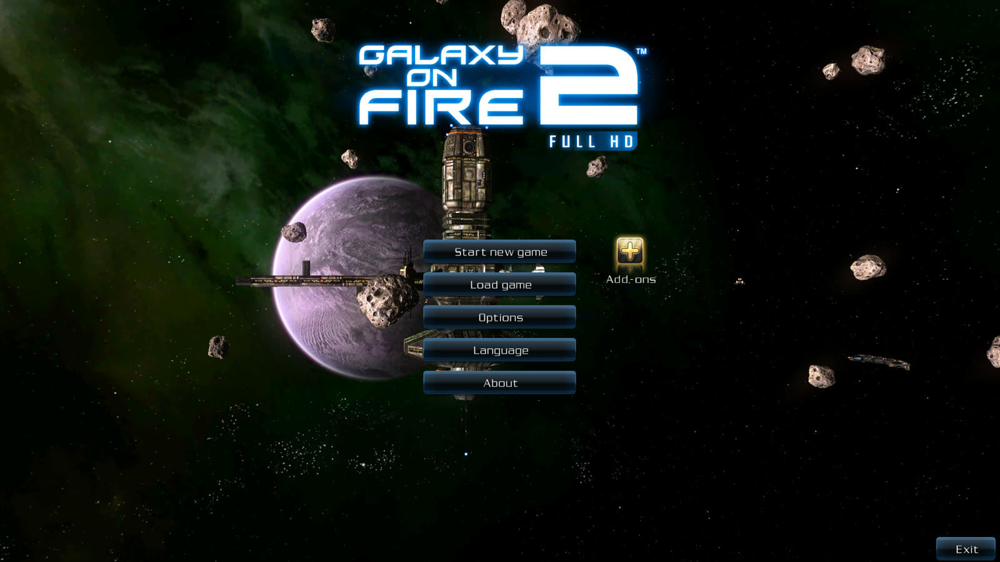
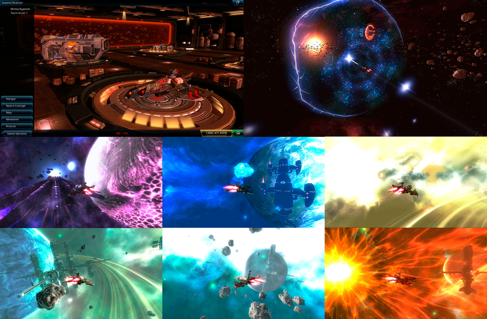

<div align="center">



# Galaxy on Fire 2 HD — Mod

[](#-requisitos)
[](#)
[](#-download)
[](#-download)
[](https://github.com/VSFLima/GOF2-HD-Mod/releases)
[](https://github.com/VSFLima/GOF2-HD-Mod/releases)

**God Mode • Todas as naves • Todos os itens • Armas fortes • DLCs liberados**

[](https://github.com/VSFLima/GOF2-HD-Mod/releases/download/v1.0/GOF2FHD_MOD.apk)
[](https://github.com/VSFLima/GOF2-HD-Mod/releases/download/v1.0/main.47947006.net.fishlabs.gof2hdallandroid2012.obb)

</div>

---

## 📸 Screenshots

<div align="center">

</div>

> Screenshots ilustrativas do jogo. Créditos: [KiritoJPK](https://github.com/KiritoJPK/Galaxy-on-Fire-2-FULL-HD-Android).

---

## ✨ O que tem no mod

### ⚔️ Combate

- **God Mode** — sua nave não sofre dano.
- **Armas primárias** — 10.000 de dano por tiro.
- **Míssil Liberator** — 999.999 de dano.
- Velocidade, recarga e rotação das armas mantidas no padrão.

### 🚀 Naves

- **Todas as naves disponíveis** para compra em qualquer estação.
- **Spectre melhorada** — HP, carga, slots e manobrabilidade elevados.

### 💰 Economia

- **Todos os itens em todas as estações.**
- **Compra infinita** — o estoque nunca esgota.
- **Créditos altos** no início.

### 🗺️ Progressão

- **Todos os sistemas solares liberados.**
- **Todas as blueprints desbloqueadas.**
- **Três campanhas** com os mods ativos: base, **Valkyrie** e **Supernova**.

### 🎮 Jogabilidade

- Sem tela preta do booster / câmera lenta.

---

## 📥 Download

| Arquivo | Tamanho | Link |
|---|---|---|
| **APK mod** — instale este | 7,8 MB | [⬇ Baixar APK](https://github.com/VSFLima/GOF2-HD-Mod/releases/download/v1.0/GOF2FHD_MOD.apk) |
| **OBB** — dados do jogo | 1,45 GB | [⬇ Baixar OBB](https://github.com/VSFLima/GOF2-HD-Mod/releases/download/v1.0/main.47947006.net.fishlabs.gof2hdallandroid2012.obb) |
| APK original (sem mod) | 6,2 MB | [Baixar](https://github.com/VSFLima/GOF2-HD-Mod/raw/main/apk/GOF2FHD_Original.apk) |

> O OBB fica na aba **Releases** porque o GitHub limita 100 MB por arquivo no código.

---

## 🛠️ Instalação

1. **Desinstale** qualquer versão anterior do Galaxy on Fire 2 HD.
2. Instale o **`GOF2FHD_MOD.apk`**.
3. Baixe o **OBB**.
4. Coloque o OBB em:

   ```
   Android/obb/net.fishlabs.gof2hdallandroid2012/main.47947006.net.fishlabs.gof2hdallandroid2012.obb
   ```

5. Abra o jogo e jogue.

> Já tem o jogo original? Basta instalar o APK mod por cima, mantendo o OBB no lugar.

---

## ⚙️ Requisitos

- Android **5.0+** (testado no Android 12)
- Suporte a apps **32-bit** (armeabi-v7a)
- ~**1,6 GB** livres para o OBB + instalação
- **Não precisa de root**

---

## ❓ FAQ

**O jogo é online?** Não. É 100% offline, sem servidor e sem anti-cheat.

**Perdi meu save?** O save fica em `Android/data/net.fishlabs.gof2hdallandroid2012/`. Faça backup antes de desinstalar.

**O jogo fecha sozinho?** Confira se o OBB está exatamente no caminho acima e com o nome correto.

**Funciona em Android 13/14/15?** Só se o aparelho ainda suportar apps 32-bit. Muitos celulares novos não suportam.

**Posso usar o APK mod com o OBB original?** Sim — o OBB é o mesmo arquivo de dados do jogo.

---

## ⚠️ Aviso

- Mod **não oficial**, feito para uso pessoal e offline.
- Galaxy on Fire 2 HD e seus assets pertencem à **Fishlabs / Deep Silver**.
- Use por sua conta e risco. Não há garantia de suporte.

---

## 🙏 Créditos

- **Mod**: VSFLima
- **Screenshots**: [KiritoJPK](https://github.com/KiritoJPK/Galaxy-on-Fire-2-FULL-HD-Android)
- **Comunidade GOF2**: 4PDA / Phantom_hat
